**English** | [Русский](README.md)

<div align="center">

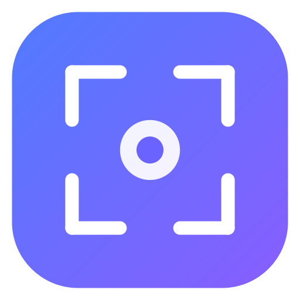

# ML IDE

**A native IDE for image annotation and YOLO training — all in one window.**
Label → check → export → train → results, with hints and explanations in plain language.


-41cd52)


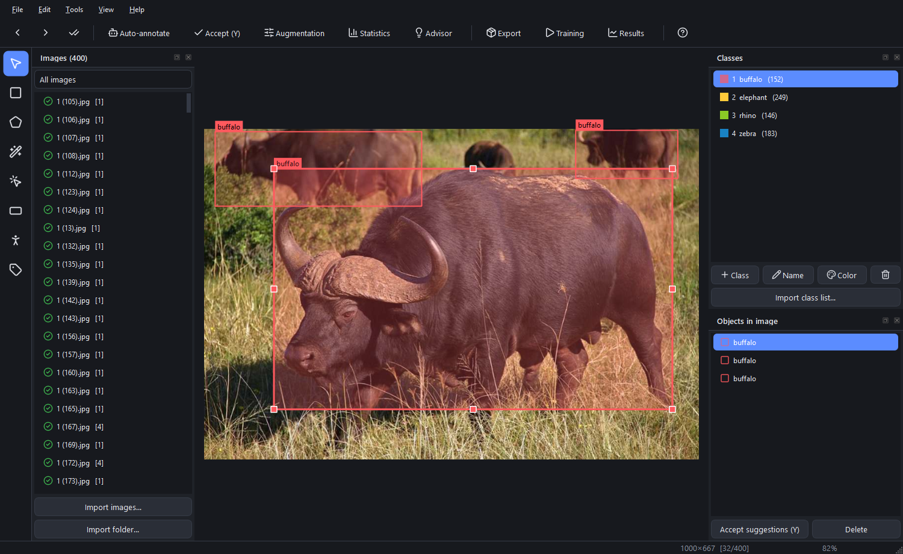

</div>

---

## Why this exists

To train a neural network to find objects in photos you need three things: **labeled data**, **the right settings** and
**an understanding of what happens during training**. ML IDE covers all three:

- it makes labeling convenient (boxes, polygons, "Smart outline") and does part of the work for you with a trained model;
- it suggests settings for your dataset and explains every parameter on mouse hover;
- it launches training, draws charts and explains **in words** what is happening and what to do next.

The program is aimed at people taking their first steps in computer vision, but it also saves time for experienced users:
a ready-made `train.py`, the right dataset format and augmentation presets are created in one click.

## Features

| | |
|---|---|
| **Import** | files, folders (recursive), drag & drop; existing **YOLO, COCO JSON, Pascal VOC** labels; **frames from video** |
| **Annotation** | boxes, polygons, **Smart outline** (rough box → edge via GrabCut), **click-to-label (SAM)**: click an object, get a precise outline; undo/redo, copy labels from the previous frame, keys 1–9 for classes |
| **Auto-annotate** | load your own `.onnx` (no PyTorch needed!) or `.pt` model — it proposes boxes/outlines, you just review them (`Y` — accept) |
| **Augmentation presets** | Light / Medium / Strong / Aerial / Night + your own, with a **live preview** on your photo |
| **Export** | YOLO (v5, v8, v9, v10, v11, v12, 26: detection, segmentation, OBB), YOLOv7, Darknet, COCO, Pascal VOC; train/val/test, background, offline augmentation |
| **Advisor** | analyzes the dataset and picks the model, epochs, image size, preset, layer freezing |
| **Training** | launch `train.py` from the program, loss/mAP/precision/recall charts and a **plain-language breakdown** |
| **Results** | open a project — see the metrics, confusion matrix, examples and test the model on any photo |
| **Model export** | `best.pt` → ONNX, TorchScript, OpenVINO, TensorRT, NCNN, TFLite, CoreML; preparation for **ESP32-S3** (ONNX 320 px + calibration images) |
| **Model viewer** | ONNX graph diagram, summary (parameters, input/output), layer list and an explanation of what each layer does |
| **Reference** | guides and a glossary of terms (mAP, epoch, batch, overfitting…) with search, tooltips on every parameter |
| **Data quality** | **duplicate / near-duplicate** search, leak-free train/val split, **label review by a model** (likely mistakes, "what to label next"), class merge and ordering |
| **Comparison and speed** | training run comparison (table, overlaid curves, verdict), model test on **video and webcam**, FPS measurement, code examples |
| **Reliability** | project backup (.bak) and recovery, finding moved files, annotation snapshots, recent projects, fast list for tens of thousands of images |
| **Language and theme** | interface in **Russian and English**, **dark and light** theme, one vector icon set (View → Language / Theme) |
| **Tasks** | **detection**, **segmentation**, **rotated boxes (OBB)**, **keypoints (pose)**, **image classification** - with YOLO export |
| **Updates and GPU** | new-version check on GitHub (only on a button press), PyTorch with CUDA installed for your graphics card |
| **Examples and tour** | 6 learning datasets with one button and an interactive tour of the interface |

## Screenshots

<table>
<tr>
<td width="50%">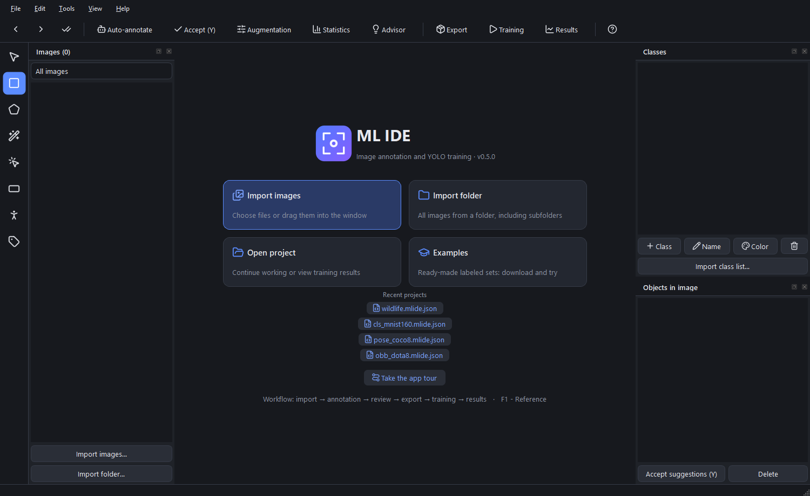<br><sub>Welcome screen</sub></td>
<td width="50%">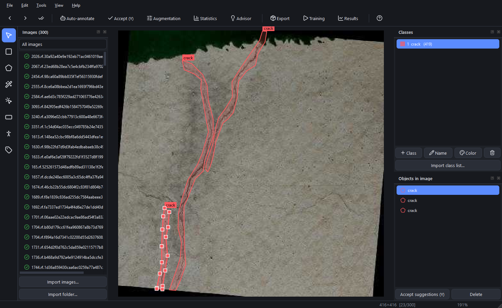<br><sub>Annotating with polygons (segmentation)</sub></td>
</tr>
<tr>
<td>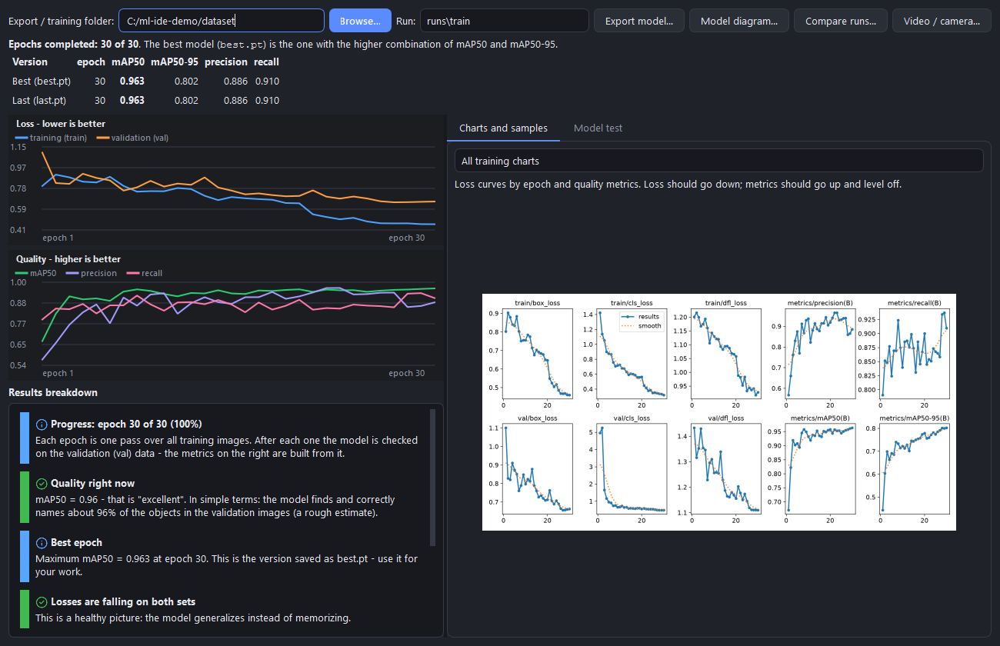<br><sub>Training results: metrics, charts, breakdown</sub></td>
<td>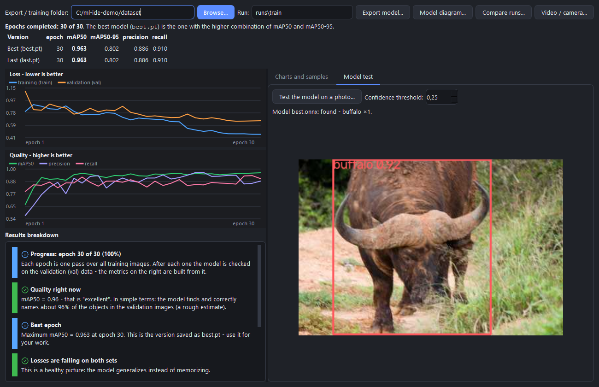<br><sub>Checking the trained model on a new photo</sub></td>
</tr>
<tr>
<td>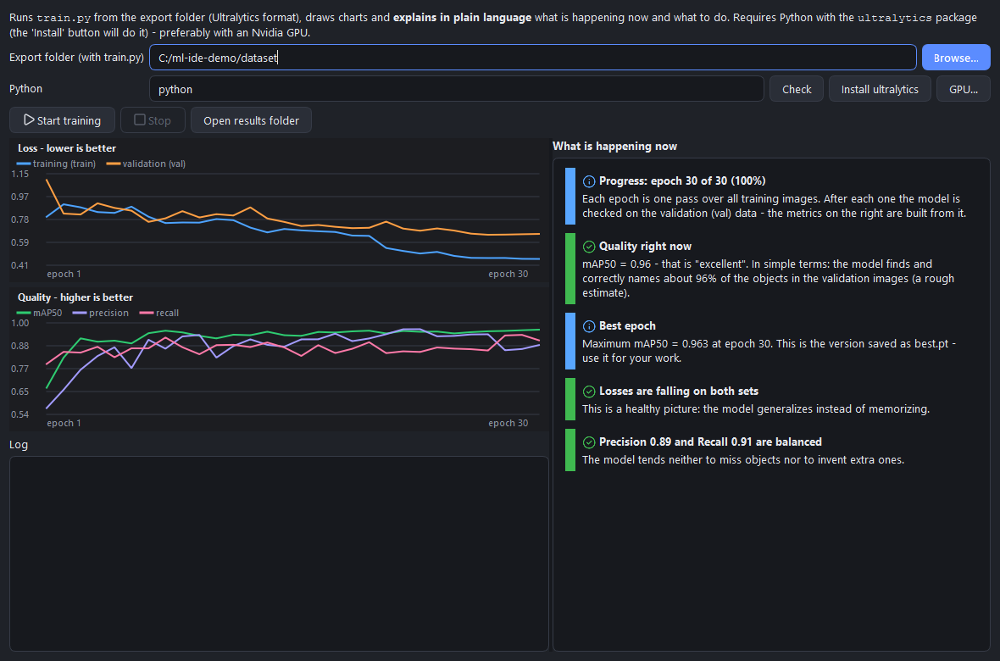<br><sub>Training with an explanation of "what is happening now"</sub></td>
<td>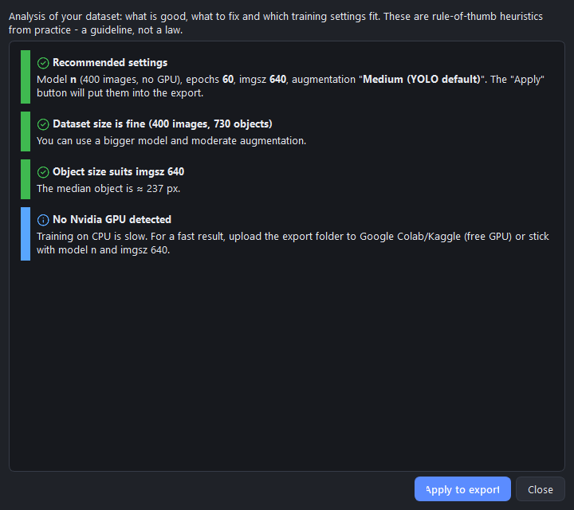<br><sub>Settings advisor</sub></td>
</tr>
<tr>
<td>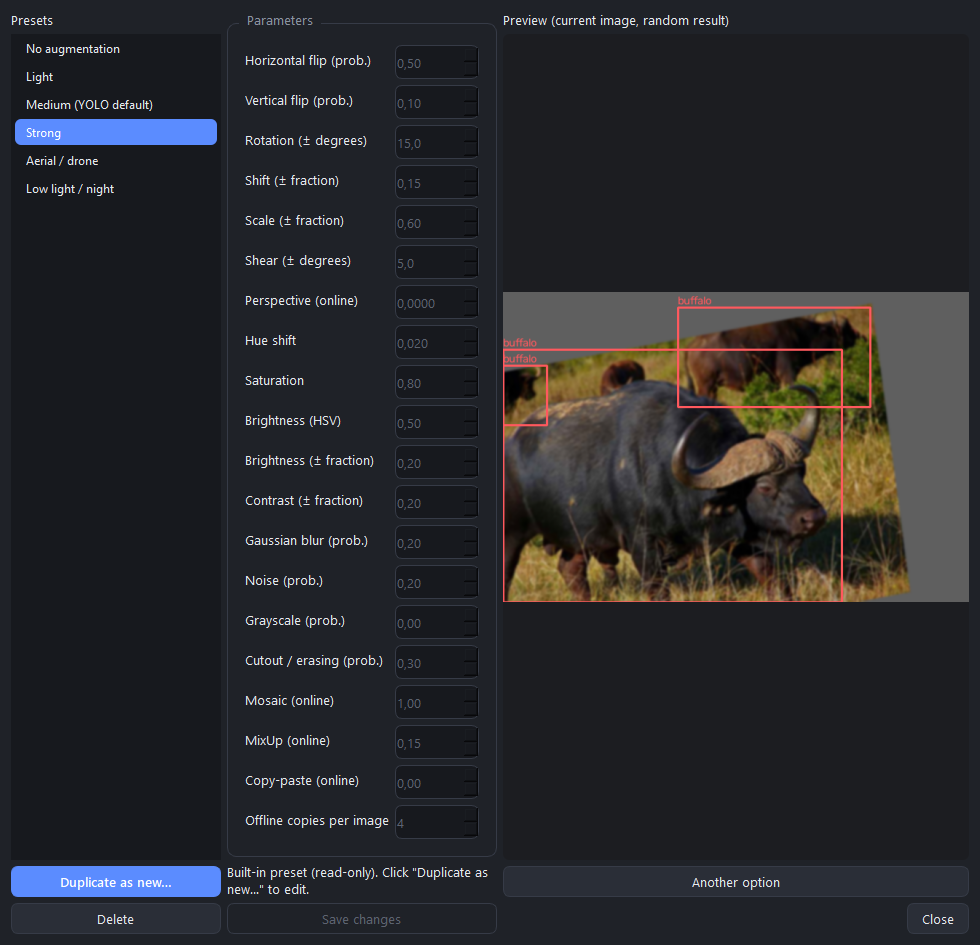<br><sub>Augmentation presets with preview</sub></td>
<td>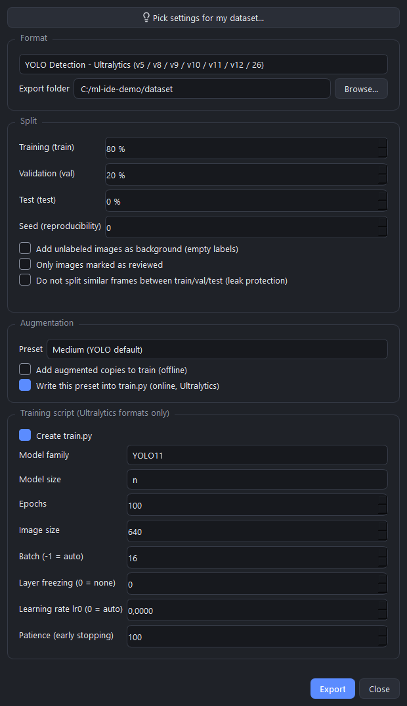<br><sub>Dataset and train.py export</sub></td>
</tr>
<tr>
<td>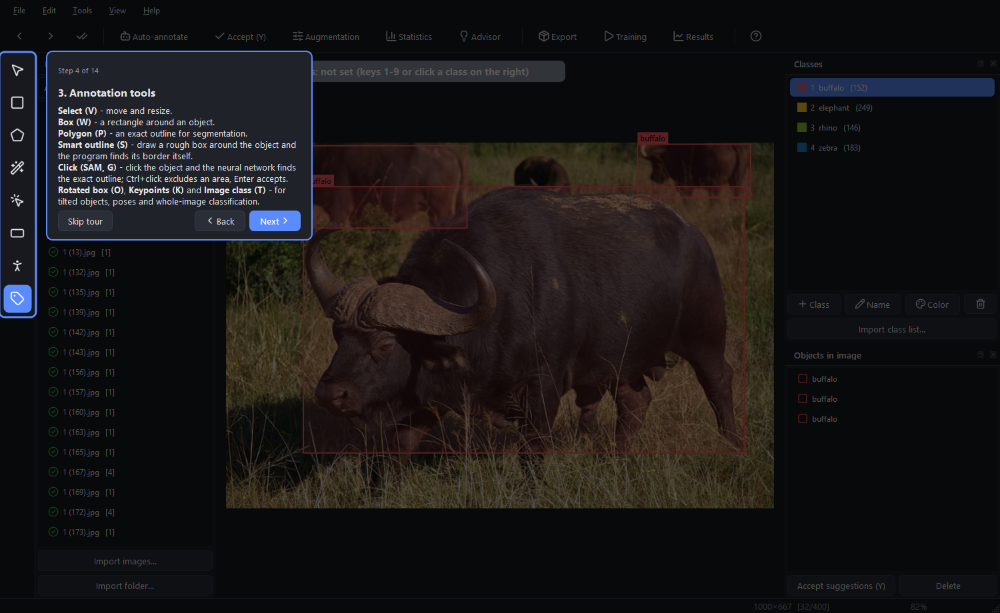<br><sub>Interactive tour</sub></td>
<td>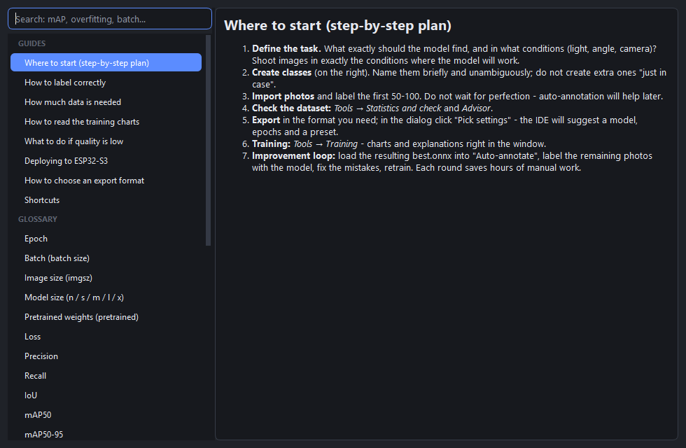<br><sub>Reference and glossary of terms</sub></td>
</tr>
</table>


### New: data quality and click-to-label

<table>
<tr>
<td width="50%">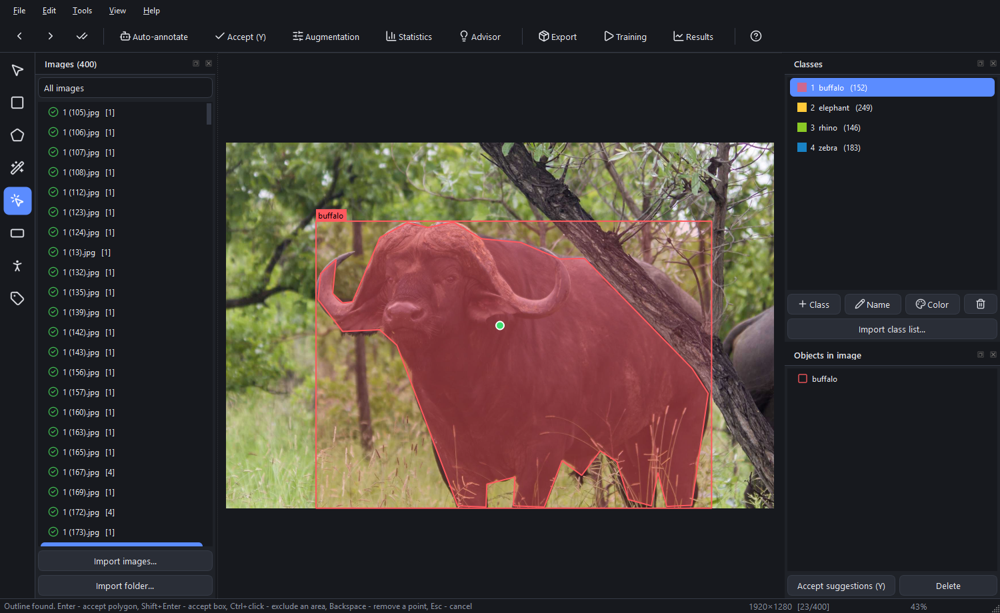<br><sub>Click (SAM): one click gives a precise object outline</sub></td>
<td width="50%">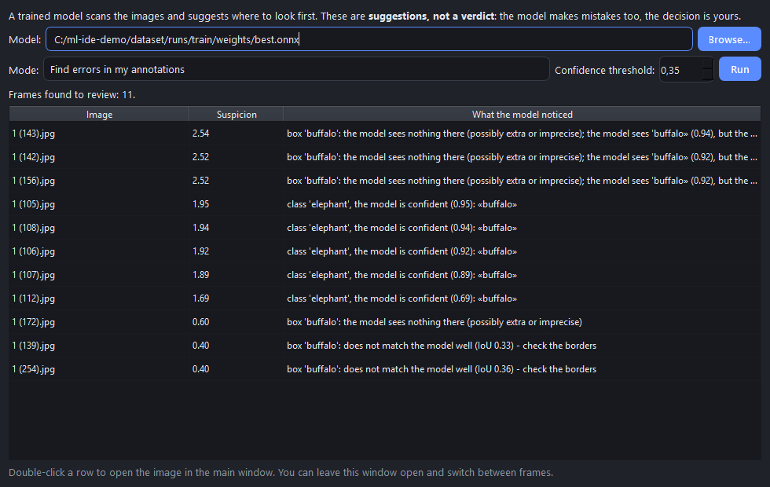<br><sub>Label review by a model: likely mistakes and suspicious frames</sub></td>
</tr>
<tr>
<td>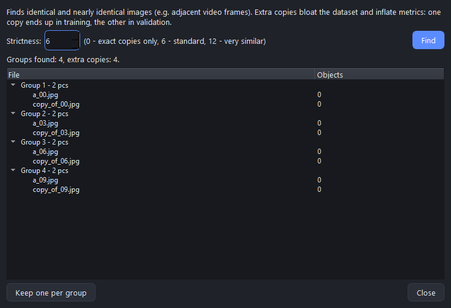<br><sub>Duplicate and near-duplicate frames</sub></td>
<td>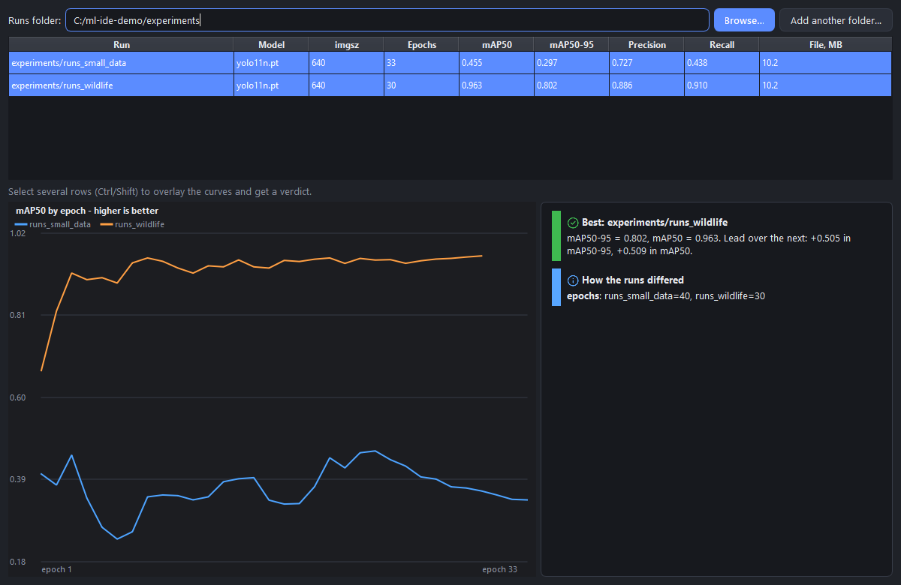<br><sub>Training run comparison</sub></td>
</tr>
<tr>
<td colspan="2">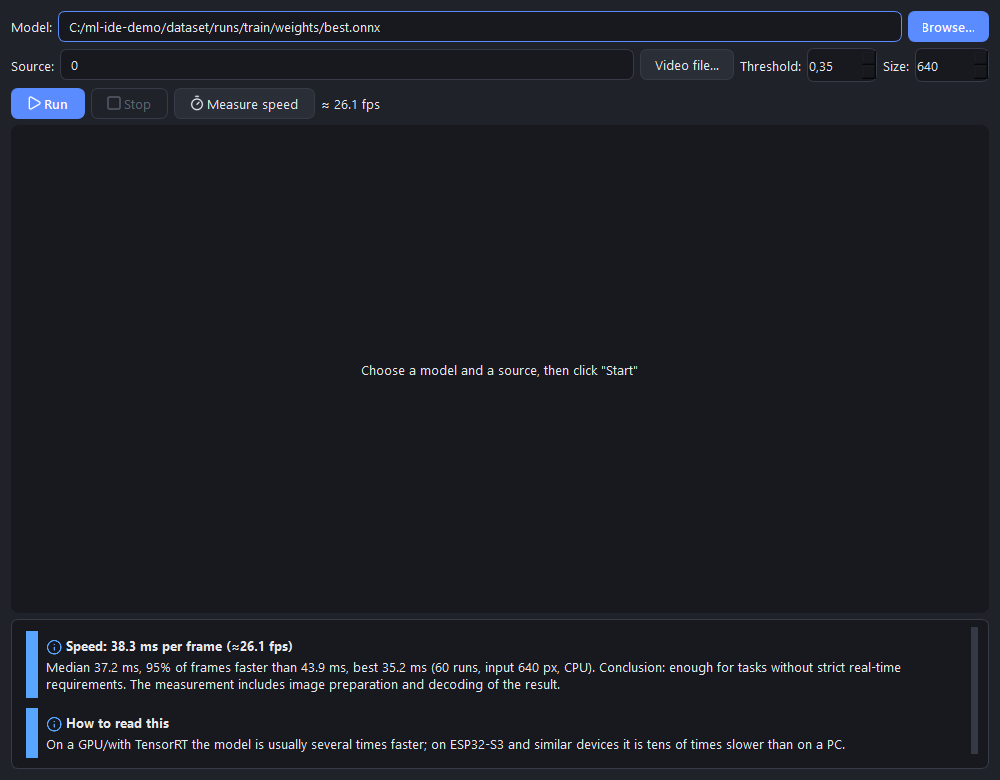<br><sub>Model test on video/camera and speed measurement</sub></td>
</tr>
</table>

## Installation

### Option 1. Ready-made `.exe` (Windows)

Download the `ML-IDE-windows.zip` archive from the [Releases](https://github.com/Serzh2000/ML-IDE/releases/latest) page, unpack **the whole folder** and run `ML IDE.exe`.
No Python needed. *(Windows SmartScreen may show a warning for an unsigned program — "More info → Run anyway".)*

### Option 2. From source

```bash
git clone https://github.com/Serzh2000/ML-IDE.git
cd ML-IDE
pip install -r requirements.txt
python -m mlide
```

Python 3.10+ is required. On Windows you can simply run `run.bat`.

### Installer

`installer/ML-IDE.iss` (Inno Setup 6) builds `ML-IDE-<version>-setup.exe` from `dist\ML IDE\`; GitHub releases build it automatically.

### Build the `.exe` yourself

```bash
pip install -r requirements-dev.txt
build_exe.bat          # result: dist\ML IDE\ML IDE.exe
```

### For training models

The IDE itself is lightweight and **does not include PyTorch**. The "Training" button needs a Python with the `ultralytics` package
(the Training window has an **"Install ultralytics"** button) — preferably with an Nvidia GPU. Without a GPU you can
train small datasets on CPU, or upload the export folder to Google Colab / Kaggle and run `train.py` there.

## Quick start in 10 minutes

1. **File → Examples** → "African wildlife" → *Download and open* (≈100 MB, once).
2. Look at the labels: images on the left, classes and objects on the right. Press **F1** to open the reference,
   or go through **Help → App tour**.
3. **Advisor** (`Ctrl+H`) — shows whether there is enough data and suggests settings.
4. **Export** (`Ctrl+E`) → format *YOLO Detection* → the **"Pick settings"** button → *Export*.
5. **Training** (`Ctrl+Shift+T`) → *Install ultralytics* (if needed) → *Start training*. The charts and explanations
   update on their own.
6. **Results** (`Ctrl+Shift+R`) → metrics, confusion matrix, **"Model check"** on your own photo.
7. Improvement loop: load the resulting `best.onnx` into **Auto-annotate**, label the remaining photos with the model,
   fix the mistakes (`Y` — accept suggestions) and retrain.

> Your own labels: **Import folder** → create classes → draw boxes (`W`) or polygons (`P`).

## Data quality and click-to-label

- **Click (SAM)** - tool `G`: click an object and the **MobileSAM** network finds its outline; `Ctrl+click` excludes an area,
  `Enter` accepts the polygon, `Shift+Enter` accepts a box. The model (~43 MB) is downloaded once from Hugging Face with your consent
  and then works offline; it needs the `onnxruntime` package (already in `requirements.txt` and in the `.exe`).
- **File → Video frames** - extract frames by time, by frame number, or on scene change.
- **Tools → Duplicates and similar frames** - finds near-identical images; the **Export** option "Do not split similar frames" keeps
  neighbouring frames of one video out of both train and val (otherwise metrics look better than they are).
- **Tools → Check annotations with a model** - the model finds likely mistakes (missed object, wrong class, loose box) or tells you
  **which frames to label next** (where it is unsure).
- **File → Import COCO / Pascal VOC labels**; right-click a class to rename, merge or move it.
- **Tools → Compare training runs** and **Test the model on video and camera** (with frames-per-second measurement).

## Model export and graph viewer

**Tools → Model export** (`Ctrl+Shift+M`) turns `best.pt` into a format for your device. For each format
it shows where it is used and suggests the right settings (FP16, INT8, dynamic size).

| Format | Where it is used |
|---|---|
| **ONNX** | universal: Windows/Linux/macOS, web, C++/C#/Java; loads back into "Auto-annotate" |
| TorchScript | C++ (LibTorch), mobile PyTorch |
| OpenVINO | Intel CPUs and GPUs |
| TensorRT | maximum speed on Nvidia GPUs |
| NCNN | Android/iOS, Raspberry Pi |
| TFLite | Android, microcontrollers, Coral |
| CoreML | iPhone / Mac |
| **ESP32-S3 / P4** | prepares a 320 px ONNX + calibration images for ESP-PPQ quantization |

**Tools → Model viewer** (`Ctrl+Shift+G`) opens an `.onnx` without installing extra packages: a summary (number of layers and
parameters, input size, decoding of the output), an interactive diagram (search, click a layer for an explanation) and a layer table.

<table>
<tr>
<td width="50%">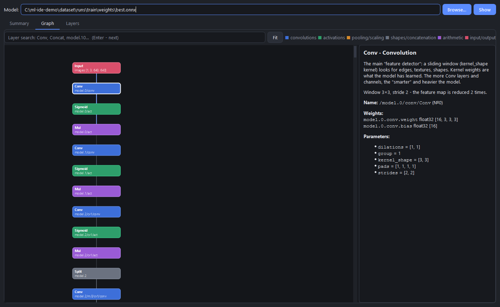<br><sub>Graph diagram: clicking a layer explains what it does</sub></td>
<td width="50%">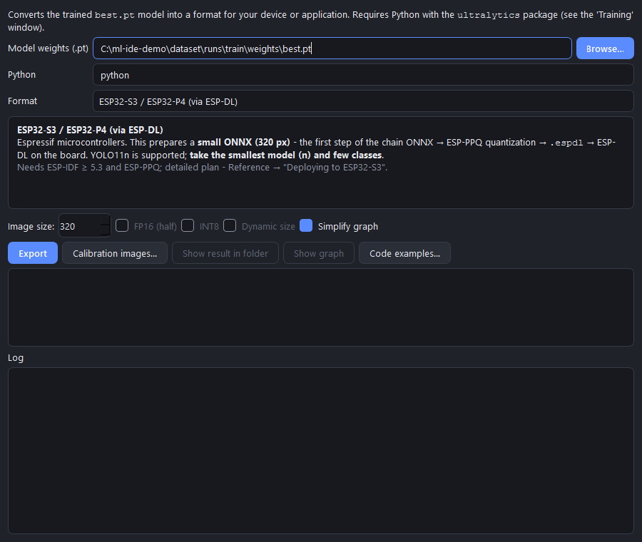<br><sub>Model export (here - preparation for ESP32-S3)</sub></td>
</tr>
</table>

### ESP32-S3

A microcontroller without a GPU, so the path is special: **a small model (YOLO11n, 320 px, few classes) → ONNX → 8-bit
quantization (ESP-PPQ) → `.espdl` → ESP-DL on the board (ESP-IDF 5.3+)**. The IDE prepares the ONNX and calibration images; a step-by-step plan is in
**Reference → "Deploying to ESP32-S3"**. Expect low speed (a few frames per second) and a slight drop in accuracy
after quantization. Espressif documentation: [How to deploy YOLO11n](https://docs.espressif.com/projects/esp-dl/en/latest/tutorials/how_to_deploy_yolo11n.html).

## Examples (learning datasets)

Downloaded with a button from the official Ultralytics GitHub; not included in the repository.

| Dataset | Type | Classes | Download | What it teaches |
|---|---|---|---|---|
| African wildlife | detection | 4 | ~100 MB | the whole path; good quality (mAP50 ≈ 0.95) |
| Pills | detection | 1 | ~8 MB | fast training on a small set |
| Signatures in documents | detection | 1 | ~11 MB | heterogeneous objects, testing on your own document |
| MRI: brain tumor (educational) | detection | 2 | ~4 MB | statistics and class balance (not for diagnosis) |
| Cracks | **segmentation** | 1 | ~92 MB | polygons, "Smart outline", `-seg` models |
| DOTA8 aerial | **rotated boxes** | 15 | ~1 MB | the Rotated box tool, `-obb` models |
| COCO8-pose | **keypoints** | 1 (17 points) | ~1 MB | the Keypoints tool, `-pose` models |
| MNIST160 | **classification** | 10 | ~1 MB | the Image class tool, `-cls` models |
| COCO: 5 classes | detection | 5 | ~7 MB | a lesson on small data and overfitting |

## Export formats

| Format | Purpose | What is created |
|---|---|---|
| **YOLO Ultralytics — Detection** | YOLOv5/v8/v9/v10/v11/v12/26 | `images/`, `labels/`, `data.yaml`, `train.py` |
| **YOLO Ultralytics — Segmentation** | `-seg` models | the same, polygon labels |
| **YOLO Ultralytics — OBB** | rotated boxes | labels with 4 corners |
| **YOLO Ultralytics — Pose** | keypoints | "box + points" labels, `kpt_shape` and `flip_idx` in `data.yaml` |
| **YOLO Ultralytics — Classify** | image classification | `train/val/<class>/` folders (no labels) |
| YOLOv7 / Roboflow | old YOLOv7/YOLOR repositories | `train/images`, `train/labels`, `data.yaml` |
| Darknet | YOLOv3 / v4 | `obj.names`, `obj.data`, `train.txt`, `valid.txt` |
| COCO JSON | YOLOX, RT-DETR, Detectron2, MMDetection | `annotations/instances_*.json` |
| Pascal VOC | old tools | `Annotations/*.xml`, `ImageSets/` |

> All YOLO versions from v5 to v12/26 share the same label format — only the model weights differ; you pick them in the export
> dialog ("Model family").

## Augmentations

Built-in presets: **No augmentation**, **Light**, **Medium (YOLO default)**, **Strong**,
**Aerial / drone**, **Dark / night**; you can duplicate any of them and tune your own.
Parameters: flips, rotation, shift, scale, shear, hue/saturation/brightness, contrast, blur, noise, grayscale,
cutouts, mosaic, MixUp, copy-paste. They are applied:

- **online** — the parameters are written to `train.py`, and Ultralytics distorts the images on the fly;
- **offline** — N augmented copies are added to the training set together with recalculated boxes/outlines
  (needed for formats without online augmentation — COCO, Darknet).

## Shortcuts

| Key | Action | Key | Action |
|---|---|---|---|
| `V` / `W` / `P` / `S` / `G` | select / box / polygon / smart outline / click (SAM) |
| `O` / `K` / `T` | rotated box / keypoints / image class | `[` `]` | rotate the selected rotated box | `A` / `D` | previous / next photo |
| `1`–`9` | choose a class (and change it for the selection) | `R` | mark as reviewed and go on |
| `Del` | delete selected | `Y` | accept auto-annotate suggestions |
| `Ctrl+Z` / `Ctrl+Shift+Z` | undo / redo | `Ctrl+D` | copy labels from the previous |
| `Wheel` | zoom | `Space` + mouse | pan |
| `Ctrl+H` | advisor | `Ctrl+L` | auto-annotate |
| `Ctrl+E` | export | `Ctrl+Shift+T` / `Ctrl+Shift+R` | training / results |
| `F1` | reference | `Shift+F1` | shortcut list |

## Project structure

```
mlide/
  model.py        data: annotations, images, project (.mlide.json)
  formats.py      YOLO / Darknet / COCO / VOC export, YOLO label import, train.py generation
  augment.py      presets and offline augmentation with box recalculation
  autolabel.py    ONNX/PT models, Smart outline (GrabCut)
  knowledge.py    reference, advisor, "translator" of training results
  examples.py     learning datasets (download and project assembly)
  modelexport.py  export of trained models (ONNX, OpenVINO, ESP32…)
  onnxparse.py    dependency-free ONNX parsing (graph, shapes, parameters)
  ui/             windows: main, canvas, dialogs, training, results, tour, welcome screen
tools/            icon and screenshot generation
tests/smoke.py    quick headless test
```

## Development

```bash
python tests/smoke.py                    # test: export of all formats, augmentations, windows
python tools/make_icon.py                # regenerate the icon
python tools/make_screenshots.py --help  # screenshots for the README
```

The test runs in GitHub Actions on every push (`.github/workflows/ci.yml`); a `v*` tag builds a release with the `.exe`
(`.github/workflows/release.yml`).

## Licenses and data

- The ML IDE code is **MIT** (see `LICENSE`).
- GUI — [PySide6 / Qt](https://doc.qt.io/qtforpython/) (LGPL), image processing — OpenCV (Apache-2.0).
- [`ultralytics`](https://github.com/ultralytics/ultralytics) (AGPL-3.0) is **not included** in the program and is not packed into the `.exe`: it is installed
  separately, only if you run training or `.pt` models. Take its license into account if you use trained models in products.
- Learning datasets are downloaded from the official Ultralytics GitHub under the AGPL-3.0 license and are not part of this repository.

## FAQ

**Training takes very long.** Without an Nvidia GPU this is normal. Use model `n`, `imgsz` 640 and fewer epochs, or
run `train.py` in Google Colab / Kaggle.

**Low mAP, what to do?** Open **Reference → "What to do if quality is low"** and "Training results" — the breakdown
will tell you whether it is overfitting, lack of data or labeling problems.

**Is internet required?** Only for downloading examples, installing `ultralytics` and the pretrained weights on the first training.
