**Русский** | [English](README.en.md)

<div align="center">

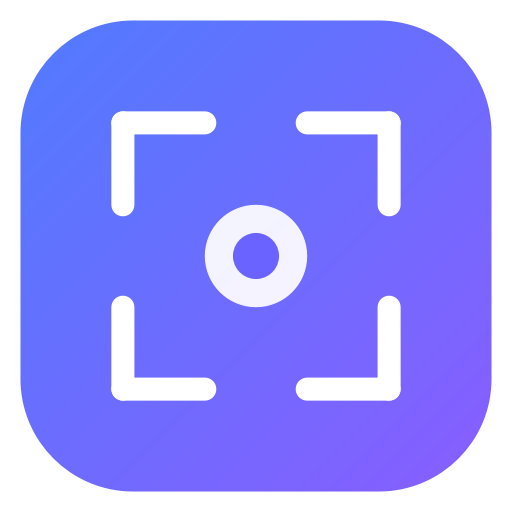

# ML IDE

**Нативная IDE для разметки изображений и обучения YOLO — всё в одном окне.**
Разметка → проверка → экспорт → обучение → результаты, с подсказками и объяснениями простым языком.


-41cd52)


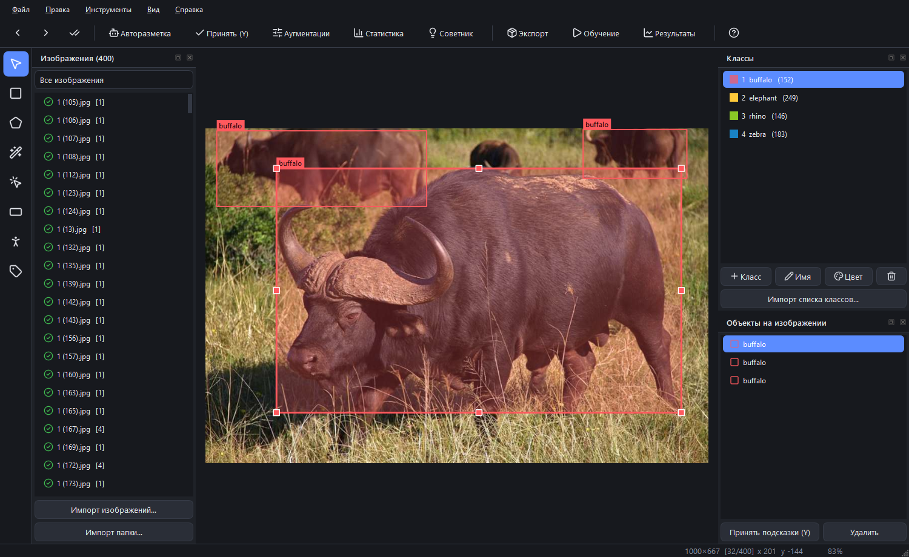

</div>

---

## Зачем это нужно

Чтобы обучить нейросеть находить объекты на фото, нужны три вещи: **размеченные данные**, **правильные настройки** и
**понимание того, что происходит во время обучения**. ML IDE закрывает все три:

- удобно размечает (рамки, полигоны, «умный контур»), а часть работы делает за вас обученной моделью;
- подсказывает настройки под ваш датасет и объясняет каждый параметр при наведении мыши;
- запускает обучение, рисует графики и **словами** объясняет, что происходит и что делать дальше.

Программа ориентирована на тех, кто делает первые шаги в компьютерном зрении, но и опытному пользователю экономит время:
готовый `train.py`, нужный формат датасета и пресеты аугментаций создаются в один клик.

## Возможности

| | |
|---|---|
| **Импорт** | файлы, папки (рекурсивно), drag & drop; готовая разметка **YOLO, COCO JSON, Pascal VOC**; **кадры из видео** |
| **Разметка** | рамки, полигоны, **умный контур** (грубая рамка → граница через GrabCut), **разметка по клику (SAM)**: кликнули по объекту — получили точный контур; undo/redo, копирование разметки с предыдущего кадра, горячие клавиши 1–9 для классов |
| **Авторазметка** | загрузите свою `.onnx` (без PyTorch!) или `.pt` модель — она предложит рамки/контуры, вы лишь проверяете (`Y` — принять) |
| **Пресеты аугментаций** | Лёгкая / Средняя / Сильная / Аэросъёмка / Ночь + свои, с **живым превью** на вашем фото |
| **Экспорт** | YOLO (v5, v8, v9, v10, v11, v12, 26: детекция, сегментация, OBB), YOLOv7, Darknet, COCO, Pascal VOC; train/val/test, фон, офлайн-аугментация |
| **Советник** | анализирует датасет и подбирает модель, эпохи, размер изображения, пресет, заморозку слоёв |
| **Обучение** | запуск `train.py` из программы, графики loss/mAP/precision/recall и **разбор простым языком** |
| **Результаты** | открыли проект — увидели метрики, матрицу ошибок, примеры и проверили модель на любом фото |
| **Экспорт модели** | `best.pt` → ONNX, TorchScript, OpenVINO, TensorRT, NCNN, TFLite, CoreML; подготовка для **ESP32-S3** (ONNX 320 px + калибровочные картинки) |
| **Просмотр модели** | схема графа ONNX, сводка (параметры, вход/выход), список слоёв и пояснение, что делает каждый слой |
| **Справочник** | руководства и словарь терминов (mAP, epoch, batch, переобучение…) с поиском, подсказки у каждого параметра |
| **Качество данных** | поиск **дублей и похожих кадров**, защита от утечки между train/val, **проверка разметки моделью** (возможные ошибки, «что размечать дальше»), объединение и порядок классов |
| **Сравнение и скорость** | сравнение запусков обучения (таблица, наложенные кривые, вывод), проверка модели на **видео и веб-камере**, замер FPS, примеры кода для запуска |
| **Надёжность** | резервная копия проекта (.bak) и восстановление, поиск перемещённых файлов, снимки разметки, недавние проекты, быстрый список на десятках тысяч изображений |
| **Язык и тема** | интерфейс на **русском и английском**, **тёмная и светлая** тема, единый набор векторных значков (Вид → Язык / Тема) |
| **Задачи** | **детекция**, **сегментация**, **повёрнутые рамки (OBB)**, **ключевые точки (pose)**, **классификация изображений** - с экспортом в YOLO |
| **Обновления и GPU** | проверка новой версии на GitHub (только по кнопке), установка PyTorch с CUDA под вашу видеокарту |
| **Примеры и тур** | каталог из 130+ учебных наборов (без регистрации, с поиском и фильтрами) и интерактивный тур по интерфейсу |

## Скриншоты

<table>
<tr>
<td width="50%">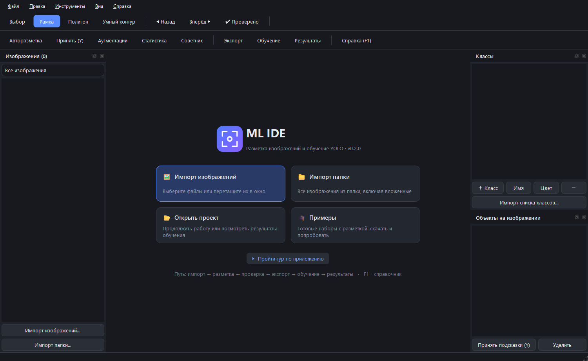<br><sub>Стартовый экран</sub></td>
<td width="50%"><br><sub>Разметка полигонами (сегментация)</sub></td>
</tr>
<tr>
<td><br><sub>Результаты обучения: метрики, графики, разбор</sub></td>
<td><br><sub>Проверка обученной модели на новом фото</sub></td>
</tr>
<tr>
<td><br><sub>Обучение с объяснением «что сейчас происходит»</sub></td>
<td><br><sub>Советник по настройкам</sub></td>
</tr>
<tr>
<td><br><sub>Пресеты аугментаций с превью</sub></td>
<td><br><sub>Экспорт датасета и train.py</sub></td>
</tr>
<tr>
<td><br><sub>Интерактивный тур</sub></td>
<td><br><sub>Справочник и словарь терминов</sub></td>
</tr>
</table>


### Новое: качество данных и разметка по клику

<table>
<tr>
<td width="50%">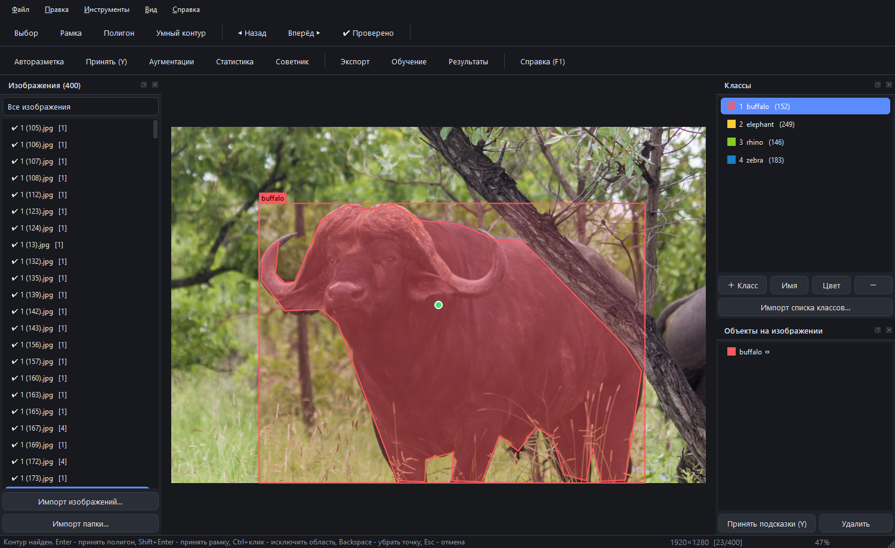<br><sub>Клик (SAM): один щелчок — точный контур объекта</sub></td>
<td width="50%">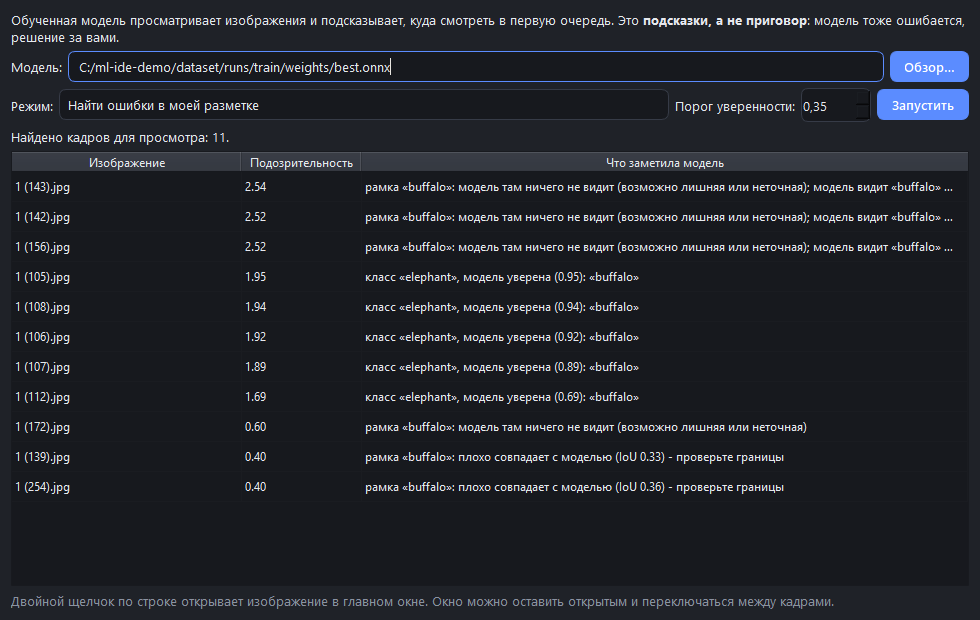<br><sub>Проверка разметки моделью: найденные ошибки и подозрительные кадры</sub></td>
</tr>
<tr>
<td>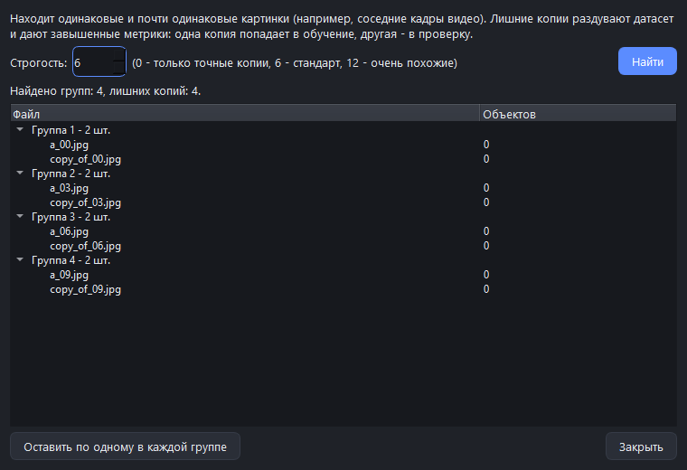<br><sub>Поиск дублей и похожих кадров</sub></td>
<td>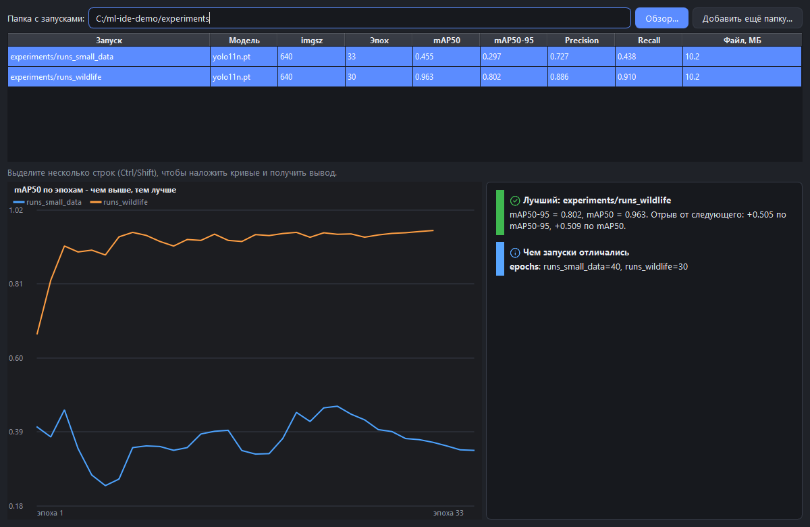<br><sub>Сравнение запусков обучения</sub></td>
</tr>
<tr>
<td colspan="2">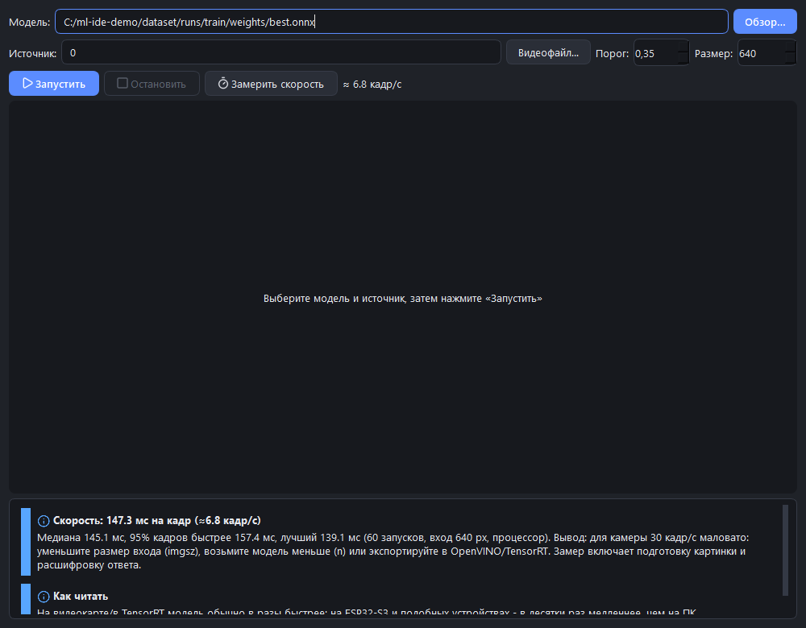<br><sub>Проверка модели на видео/камере и замер скорости</sub></td>
</tr>
</table>

## Импорт готовой разметки (любой формат)

**Файл → Импорт разметки (любой формат)…** (`Ctrl+Shift+L`): выберите папку или файлы, формат определится сам, картинки найдутся по именам и путям
из файлов разметки. Окно показывает, сколько картинок найдено, и позволяет сопоставить классы (переименовать, пропустить).

| Что понимает | Подробности |
|---|---|
| **YOLO / Ultralytics / Darknet** | txt на картинку (рамки, полигоны, повёрнутые рамки, ключевые точки), `data.yaml` / `classes.txt` / `obj.names`; метки могут лежать в любой папке |
| **COCO** | рамки, полигоны (все части), ключевые точки, несколько json сразу; файлы результатов `score` |
| **Pascal VOC / LabelImg**, **CVAT**, **LabelMe**, **VIA**, **Label Studio**, **CreateML** | рамки, полигоны, повёрнутые рамки, классы кадров |
| **DOTA, KITTI** и txt с пиксельными координатами | `x1 y1 ... класс`, `класс x1 y1 x2 y2` и другие раскладки |
| **Таблицы CSV / TSV / JSON / JSONL** | столбцы определяются по названиям и содержимому (`filename, class, xmin, ymin, xmax, ymax`, `bbox`, `polygon`, доли кадра или пиксели); сопоставление столбцов можно поправить вручную |
| **Файл-сопоставление** | список «картинка → файл разметки» (`pairs.csv`, JSON-словарь, текстовый список): сами файлы разметки читаются подходящим разборщиком |
| **Папки = классы** | классификация: `cat/1.jpg`, `dog/2.jpg` |

Разметку можно добавить к уже загруженным картинкам (дописать, заменить или пропустить размеченные). При добавлении папки с картинками, рядом с которыми
лежит разметка, приложение само предложит открыть мастер импорта.

### Новые задачи и каталог примеров

<table>
<tr>
<td width="50%">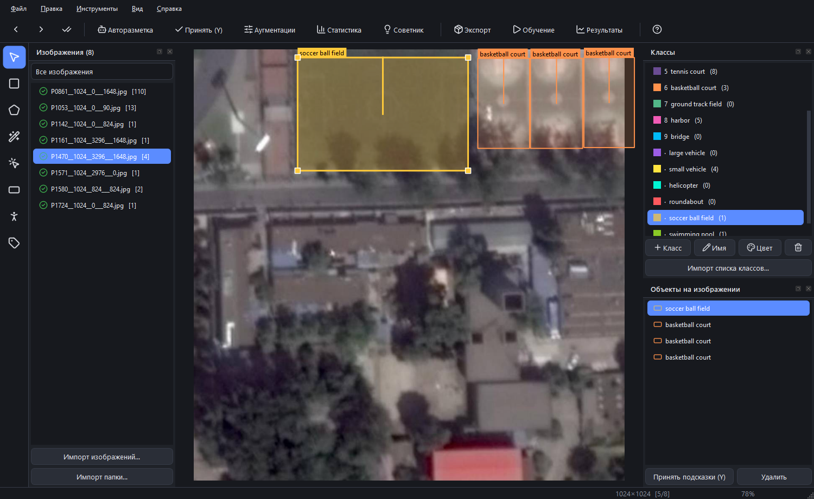<br><sub>Повёрнутые рамки (OBB): аэроснимки</sub></td>
<td width="50%">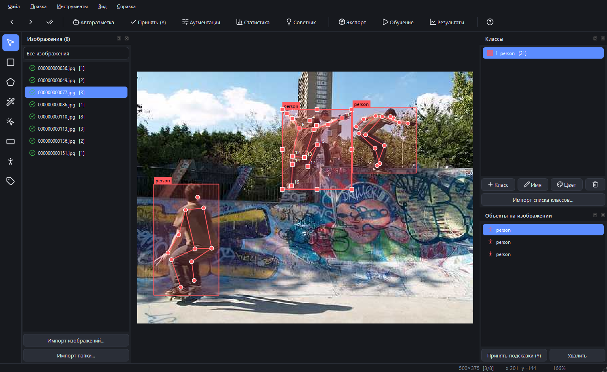<br><sub>Ключевые точки (pose): скелет и точки</sub></td>
</tr>
<tr>
<td>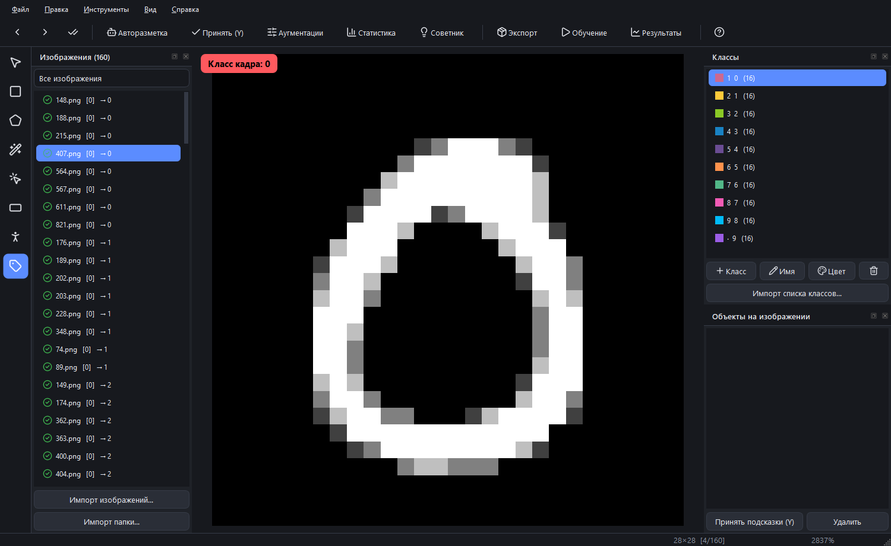<br><sub>Классификация изображений: класс кадра одной клавишей</sub></td>
<td>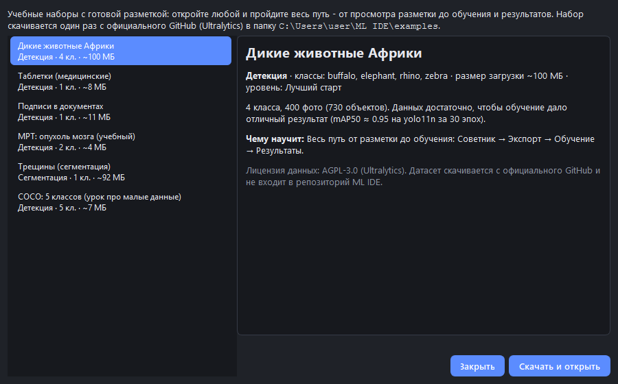<br><sub>Каталог из 130 учебных наборов: поиск и фильтры</sub></td>
</tr>
</table>

## Установка

### Вариант 1. Готовый `.exe` (Windows)

На странице [Releases](https://github.com/Serzh2000/ML-IDE/releases/latest) два файла:

- **`ML-IDE-<версия>-setup.exe`** — установщик (русский и английский язык мастера; язык интерфейса выбирается по языку установщика);
- **`ML-IDE-<версия>-portable.zip`** — портативная версия: распакуйте **всю папку** куда угодно (хоть на флешку) и запустите `ML IDE.exe`. Настройки и скачанные примеры хранятся в папке `data` рядом с программой, реестр не используется.

Python не нужен. Язык интерфейса (русский / английский) при первом запуске выбирается по языку системы, меняется в меню **Вид → Язык**. *(Windows SmartScreen может показать предупреждение для неподписанной программы — «Подробнее → Выполнить в любом случае».)*

### Вариант 2. Из исходников

```bash
git clone https://github.com/Serzh2000/ML-IDE.git
cd ML-IDE
pip install -r requirements.txt
python -m mlide
```

Нужен Python 3.10+. На Windows можно просто запустить `run.bat`.

### Сборка установщика

Скрипт `installer/ML-IDE.iss` (Inno Setup 6) собирает `ML-IDE-<версия>-setup.exe` из `dist\ML IDE\`; в релизах на GitHub он создаётся автоматически.

### Собрать `.exe` самостоятельно

```bash
pip install -r requirements-dev.txt
build_exe.bat          # результат: dist\ML IDE\ML IDE.exe
```

### Для обучения моделей

Сама IDE лёгкая и **не содержит PyTorch**. Для кнопки «Обучение» нужен Python с пакетом `ultralytics`
(в окне «Обучение» есть кнопка **«Установить ultralytics»**) — лучше с видеокартой Nvidia. Без видеокарты можно
обучать на CPU небольшие датасеты либо загрузить папку экспорта в Google Colab / Kaggle и запустить там `train.py`.

## Быстрый старт за 10 минут

1. **Файл → Примеры** → «Дикие животные Африки» → *Скачать и открыть* (≈100 МБ, один раз).
2. Посмотрите разметку: слева изображения, справа классы и объекты. Нажмите **F1**, чтобы открыть справочник,
   или пройдите **Справка → Тур по приложению**.
3. **Советник** (`Ctrl+H`) — покажет, достаточно ли данных, и предложит настройки.
4. **Экспорт** (`Ctrl+E`) → формат *YOLO Детекция* → кнопка **«Подобрать настройки»** → *Экспортировать*.
5. **Обучение** (`Ctrl+Shift+T`) → *Установить ultralytics* (если нужно) → *Начать обучение*. Графики и пояснения
   обновляются сами.
6. **Результаты** (`Ctrl+Shift+R`) → метрики, матрица ошибок, **«Проверка модели»** на своём фото.
7. Цикл улучшения: загрузите полученный `best.onnx` в **Авторазметку**, разметьте остальные фото машиной,
   исправьте ошибки (`Y` — принять подсказки) и переобучите.

> Своя разметка: **Импорт папки** → создайте классы → рисуйте рамки (`W`) или полигоны (`P`).

## Качество данных и разметка по клику

- **Клик (SAM)** — инструмент `G`: кликните по объекту, нейросеть **MobileSAM** найдёт его контур; `Ctrl+клик` исключает область,
  `Enter` принимает полигон, `Shift+Enter` — рамку. Модель (≈43 МБ) скачивается один раз с Hugging Face по вашему согласию и дальше
  работает офлайн; нужен пакет `onnxruntime` (уже в `requirements.txt` и в `.exe`).
- **Файл → Кадры из видео** — нарезка по времени, по номеру кадра или при смене сцены.
- **Инструменты → Дубли и похожие кадры** — поиск почти одинаковых картинок; в **Экспорте** галочка «Не разделять похожие кадры»
  не даёт соседним кадрам одного видео попасть и в train, и в val (иначе метрики завышены).
- **Инструменты → Проверка разметки моделью** — модель находит возможные ошибки (пропущенный объект, не тот класс, неточная рамка)
  или подсказывает, **какие кадры размечать дальше** (где она неуверена).
- **Файл → Импорт разметки COCO / Pascal VOC**; правый клик по классу — переименовать, объединить, переместить.
- **Инструменты → Сравнение запусков** и **Тест модели на видео и камере** (с замером кадров в секунду).

## Экспорт модели и просмотр графа

**Инструменты → Экспорт модели** (`Ctrl+Shift+M`) превращает `best.pt` в формат для вашего устройства. Для каждого формата
показано, где он применяется, и подсказаны нужные настройки (FP16, INT8, динамический размер).

| Формат | Где используется |
|---|---|
| **ONNX** | универсально: Windows/Linux/macOS, веб, C++/C#/Java; загружается обратно в «Авторазметку» |
| TorchScript | C++ (LibTorch), мобильный PyTorch |
| OpenVINO | процессоры и видеокарты Intel |
| TensorRT | максимальная скорость на видеокартах Nvidia |
| NCNN | Android/iOS, Raspberry Pi |
| TFLite | Android, микроконтроллеры, Coral |
| CoreML | iPhone / Mac |
| **ESP32-S3 / P4** | подготовка ONNX 320 px + калибровочные картинки для квантования ESP-PPQ |

**Инструменты → Просмотр модели** (`Ctrl+Shift+G`) открывает `.onnx` без установки дополнительных пакетов: сводка (число слоёв и
параметров, размер входа, расшифровка выхода), интерактивная схема (поиск, клик по слою - пояснение) и таблица слоёв.

<table>
<tr>
<td width="50%">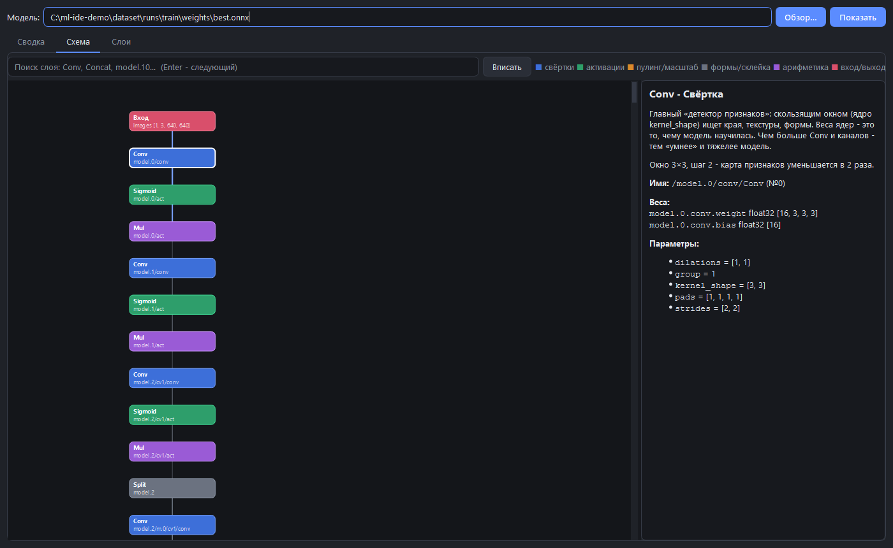<br><sub>Схема графа: клик по слою объясняет, что он делает</sub></td>
<td width="50%">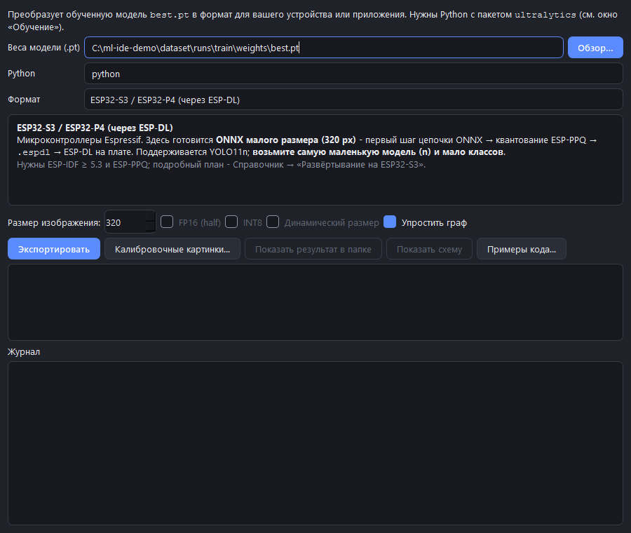<br><sub>Экспорт модели (здесь - подготовка для ESP32-S3)</sub></td>
</tr>
</table>

### ESP32-S3

Микроконтроллер без видеокарты, поэтому путь особый: **маленькая модель (YOLO11n, 320 px, мало классов) → ONNX → квантование
в 8 бит (ESP-PPQ) → `.espdl` → ESP-DL на плате (ESP-IDF 5.3+)**. IDE готовит ONNX и калибровочные картинки; пошаговый план есть
в **Справочнике → «Развёртывание на ESP32-S3»**. Ожидайте низкую скорость (единицы кадров в секунду) и небольшое падение точности
после квантования. Документация Espressif: [How to deploy YOLO11n](https://docs.espressif.com/projects/esp-dl/en/latest/tutorials/how_to_deploy_yolo11n.html).

## Примеры (учебные наборы)

В каталоге **130+ наборов** (детекция, сегментация, повёрнутые рамки, ключевые точки, классификация) с поиском и фильтрами по задаче и теме. Всё скачивается **без регистрации и ключей** и не входит в репозиторий:

- **Ultralytics** (GitHub): COCO8/32/128, KITTI, стройка, дома, детали авто, руки, собаки, тигры, DOTA, MNIST, CIFAR, Imagenette и другие;
- **Roboflow 100** на Hugging Face: 96 разнотипных наборов (медицина, аэросъёмка, документы, видеоигры, микроскопия, промышленность);
- отдельные наборы Hugging Face и **любой свой** набор с картинками и рамками (кнопка «Свой набор с Hugging Face…»).

Из больших наборов берётся выборка кадров (обычно до 300): скачивается мегабайты, а не гигабайты. Кнопка «Обновить каталог» подтягивает свежий список из репозитория. Лицензия каждого набора показана в окне.

Подборка основных примеров:

| Набор | Тип | Классы | Загрузка | Чему учит |
|---|---|---|---|---|
| Дикие животные Африки | детекция | 4 | ~100 МБ | весь путь; хорошее качество (mAP50 ≈ 0.95) |
| Таблетки | детекция | 1 | ~8 МБ | быстрое обучение на небольшом наборе |
| Подписи в документах | детекция | 1 | ~11 МБ | разнородные объекты, проверка на своём документе |
| МРТ: опухоль мозга (учебный) | детекция | 2 | ~4 МБ | статистика и баланс классов (не для диагностики) |
| Трещины | **сегментация** | 1 | ~92 МБ | полигоны, «умный контур», `-seg` модели |
| Аэроснимки DOTA8 | **повёрнутые рамки** | 15 | ~1 МБ | инструмент «Повёрнутая рамка», `-obb` модели |
| COCO8-pose | **ключевые точки** | 1 (17 точек) | ~1 МБ | инструмент «Ключевые точки», `-pose` модели |
| MNIST160 | **классификация** | 10 | ~1 МБ | инструмент «Класс кадра», `-cls` модели |
| COCO: 5 классов | детекция | 5 | ~7 МБ | урок про малые данные и переобучение |

## Форматы экспорта

| Формат | Для чего | Что создаётся |
|---|---|---|
| **YOLO Ultralytics — Detection** | YOLOv5/v8/v9/v10/v11/v12/26 | `images/`, `labels/`, `data.yaml`, `train.py` |
| **YOLO Ultralytics — Segmentation** | `-seg` модели | то же, метки-полигоны |
| **YOLO Ultralytics — OBB** | повёрнутые рамки | метки с 4 углами |
| **YOLO Ultralytics — Pose** | ключевые точки | метки «рамка + точки», `kpt_shape` и `flip_idx` в `data.yaml` |
| **YOLO Ultralytics — Classify** | классификация изображений | папки `train/val/<класс>/` (без меток) |
| YOLOv7 / Roboflow | старые репозитории YOLOv7/YOLOR | `train/images`, `train/labels`, `data.yaml` |
| Darknet | YOLOv3 / v4 | `obj.names`, `obj.data`, `train.txt`, `valid.txt` |
| COCO JSON | YOLOX, RT-DETR, Detectron2, MMDetection | `annotations/instances_*.json` |
| Pascal VOC | старые инструменты | `Annotations/*.xml`, `ImageSets/` |

> У всех версий YOLO от v5 до v12/26 формат меток одинаковый — отличаются только веса модели, их выбирают в диалоге
> экспорта («Семейство модели»).

## Аугментации

Встроенные пресеты: **Без аугментаций**, **Лёгкая**, **Средняя (по умолчанию YOLO)**, **Сильная**,
**Аэросъёмка / дрон**, **Тёмное время / ночь**; можно дублировать любой и настроить свой.
Параметры: отражения, поворот, сдвиг, масштаб, скос, оттенок/насыщенность/яркость, контраст, размытие, шум, ч/б,
вырезы, мозаика, MixUp, copy-paste. Применяются:

- **онлайн** — параметры записываются в `train.py`, Ultralytics искажает картинки на лету;
- **офлайн** — N аугментированных копий добавляются в обучающую выборку вместе с пересчитанными рамками/контурами
  (нужно для форматов без онлайн-аугментации — COCO, Darknet).

## Горячие клавиши

| Клавиша | Действие | Клавиша | Действие |
|---|---|---|---|
| `V` / `W` / `P` / `S` / `G` | выбор / рамка / полигон / умный контур / клик (SAM) |
| `O` / `K` / `T` | повёрнутая рамка / ключевые точки / класс кадра | `[` `]` | повернуть выбранную повёрнутую рамку | `A` / `D` | предыдущее / следующее фото |
| `1`–`9` | выбрать класс (и сменить у выделенного) | `R` | отметить проверенным и дальше |
| `Del` | удалить выбранное | `Y` | принять подсказки авторазметки |
| `Ctrl+Z` / `Ctrl+Shift+Z` | отмена / повтор | `Ctrl+D` | копировать разметку с предыдущего |
| `Колесо` | масштаб | `Пробел` + мышь | сдвиг |
| `Ctrl+H` | советник | `Ctrl+L` | авторазметка |
| `Ctrl+E` | экспорт | `Ctrl+Shift+T` / `Ctrl+Shift+R` | обучение / результаты |
| `F1` | справочник | `Shift+F1` | список горячих клавиш |

## Структура проекта

```
mlide/
  model.py        данные: аннотации, изображения, проект (.mlide.json)
  formats.py      экспорт YOLO / Darknet / COCO / VOC, импорт YOLO-меток, генерация train.py
  augment.py      пресеты и офлайн-аугментация с пересчётом рамок
  autolabel.py    ONNX/PT модели, умный контур (GrabCut)
  knowledge.py    справочник, советник, «переводчик» результатов обучения
  examples.py     учебные наборы (скачивание и сборка проекта)
  keypoints.py    наборы ключевых точек;  updates.py - проверка обновлений;  settings.py - настройки
  modelexport.py  экспорт обученных моделей (ONNX, OpenVINO, ESP32…)
  onnxparse.py    разбор ONNX без зависимостей (граф, формы, параметры)
  ui/             окна: главное, холст, диалоги, обучение, результаты, тур, стартовый экран
tools/            генерация иконки и скриншотов
tests/smoke.py    быстрый тест без экрана
```

## Разработка

```bash
python tests/smoke.py                    # тест: экспорт всех форматов, аугментации, окна
python tools/make_icon.py                # пересоздать иконку
python tools/make_screenshots.py --help  # скриншоты для README
```

Тест запускается в GitHub Actions на каждый push (`.github/workflows/ci.yml`); по тегу `v*` собирается релиз с `.exe`
(`.github/workflows/release.yml`).

## Лицензии и данные

- Код ML IDE — **MIT** (см. `LICENSE`).
- GUI — [PySide6 / Qt](https://doc.qt.io/qtforpython/) (LGPL), обработка изображений — OpenCV (Apache-2.0).
- [`ultralytics`](https://github.com/ultralytics/ultralytics) (AGPL-3.0) **не входит** в программу и не упаковывается в `.exe`: он ставится
  отдельно, только если вы запускаете обучение или `.pt`-модели. Учитывайте его лицензию, если используете обученные модели в продуктах.
- Схема модели открывается в [Netron](https://github.com/lutzroeder/netron) (MIT, © Lutz Roeder): его файлы лежат в `assets/netron`, работает локально, без отправки модели и статистики.
- Учебные наборы не входят в репозиторий и скачиваются с Ultralytics (AGPL-3.0) и Hugging Face (Roboflow 100: CC BY 4.0, прочие - по лицензии автора, она показана в окне «Примеры»).

## Частые вопросы

**Обучение идёт очень долго.** Без видеокарты Nvidia это нормально. Берите модель `n`, `imgsz` 640 и меньше эпох либо
запускайте `train.py` в Google Colab / Kaggle.

**Низкий mAP, что делать?** Откройте **Справочник → «Что делать, если качество низкое»** и «Результаты обучения» — разбор
подскажет, переобучение это, нехватка данных или проблемы с разметкой.

**Нужен ли интернет?** Только для скачивания примеров, установки `ultralytics` и предобученных весов при первом обучении.
