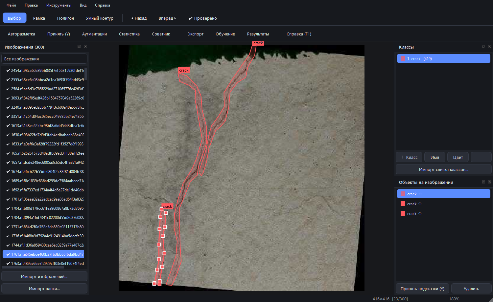
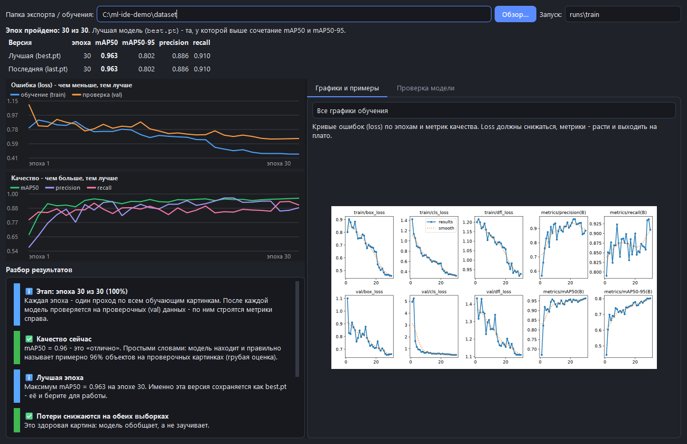
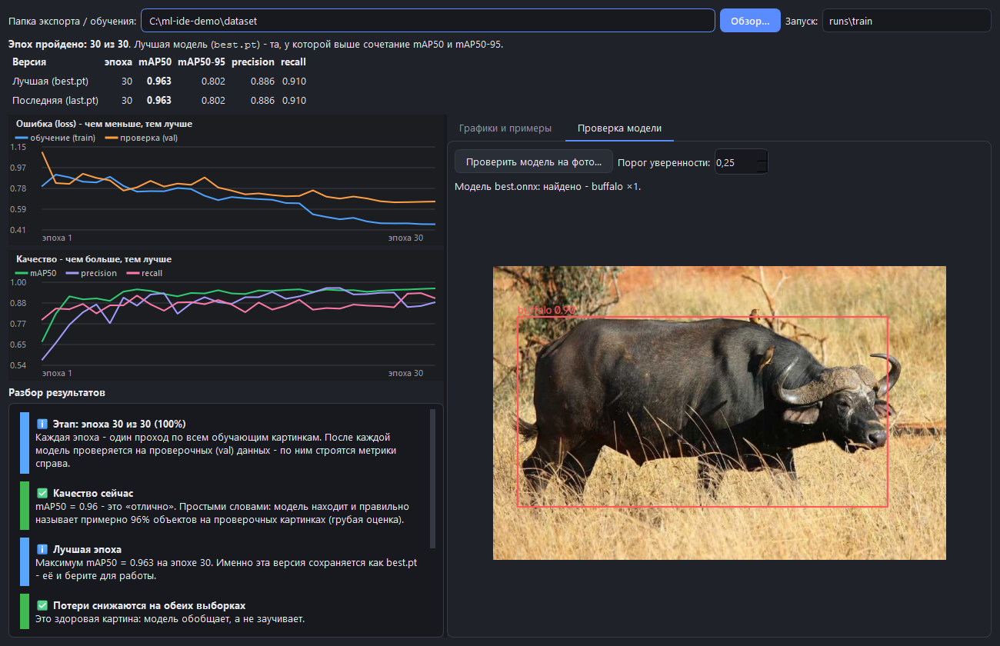
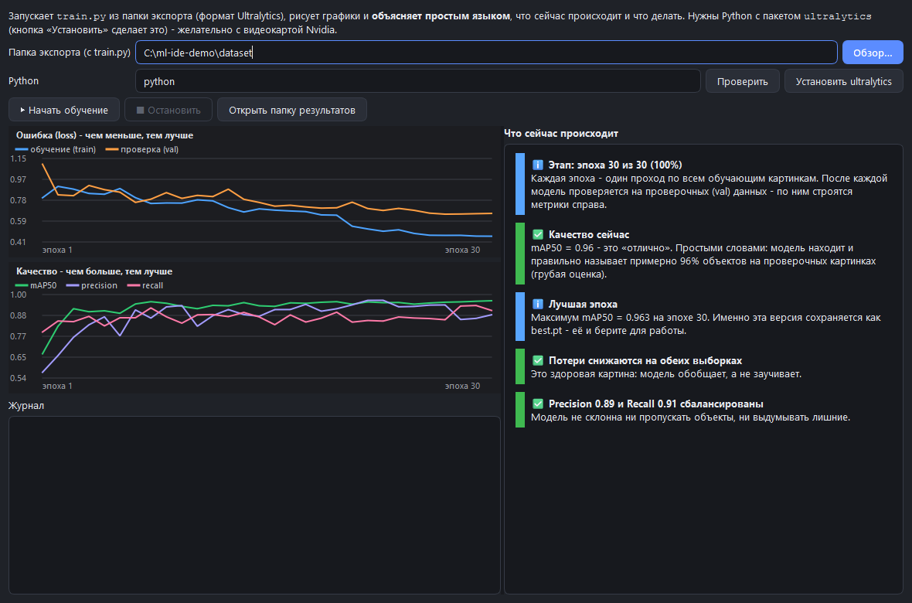
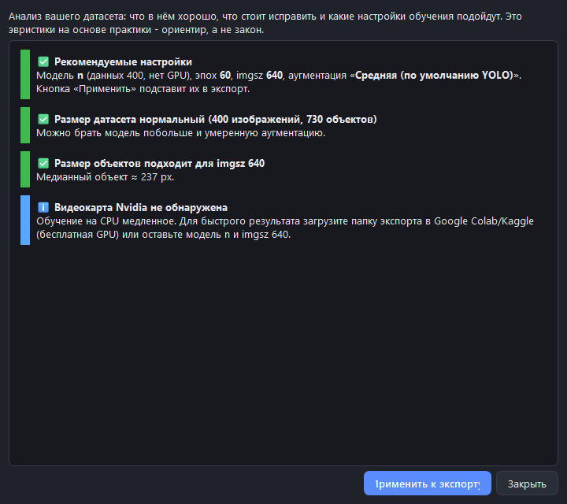
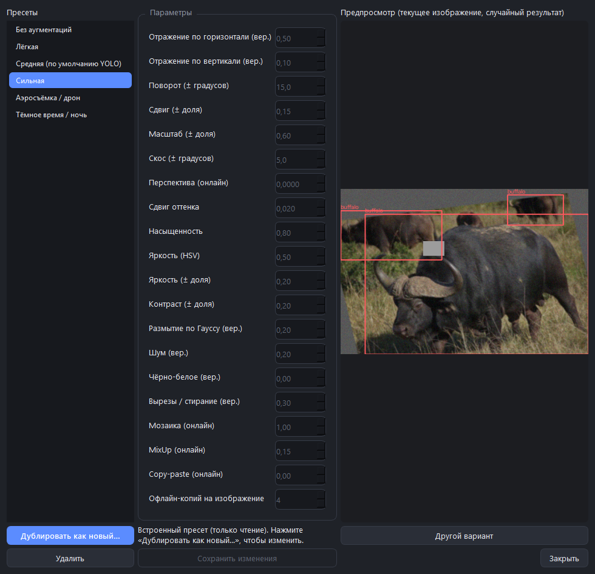
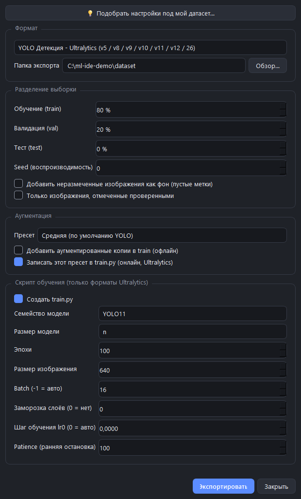
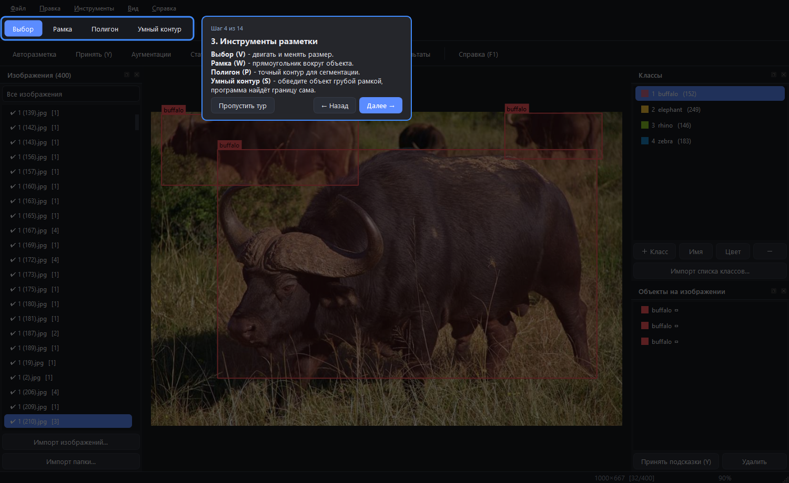
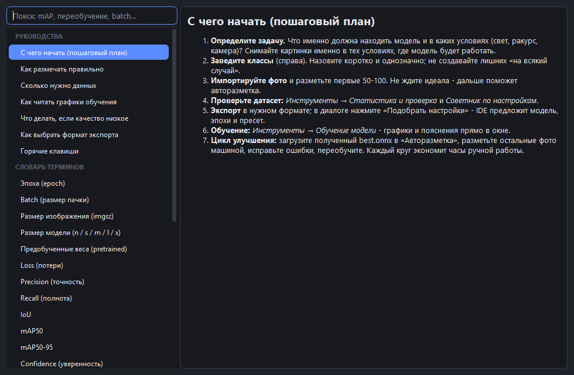

<div align="center">


# ML IDE

**Нативная IDE для разметки изображений и обучения YOLO — всё в одном окне.**
Разметка → проверка → экспорт → обучение → результаты, с подсказками и объяснениями простым языком.


-41cd52)


</div>

---

## Зачем это нужно

Чтобы обучить нейросеть находить объекты на фото, нужны три вещи: **размеченные данные**, **правильные настройки** и
**понимание того, что происходит во время обучения**. ML IDE закрывает все три:

- удобно размечает (рамки, полигоны, «умный контур»), а часть работы делает за вас обученной моделью;
- подсказывает настройки под ваш датасет и объясняет каждый параметр при наведении мыши;
- запускает обучение, рисует графики и **словами** объясняет, что происходит и что делать дальше.

Программа ориентирована на тех, кто делает первые шаги в компьютерном зрении, но и опытному пользователю экономит время:
готовый `train.py`, нужный формат датасета и пресеты аугментаций создаются в один клик.

## Возможности

| | |
|---|---|
| 🖼 **Импорт** | файлы, папки (рекурсивно), drag & drop; подхватывает готовую YOLO-разметку |
| ✏️ **Разметка** | рамки, полигоны, **умный контур** (грубая рамка → точная граница через GrabCut), undo/redo, копирование разметки с предыдущего кадра, горячие клавиши 1–9 для классов |
| 🤖 **Авторазметка** | загрузите свою `.onnx` (без PyTorch!) или `.pt` модель — она предложит рамки/контуры, вы лишь проверяете (`Y` — принять) |
| 🎛 **Пресеты аугментаций** | Лёгкая / Средняя / Сильная / Аэросъёмка / Ночь + свои, с **живым превью** на вашем фото |
| 📦 **Экспорт** | YOLO (v5, v8, v9, v10, v11, v12, 26: детекция, сегментация, OBB), YOLOv7, Darknet, COCO, Pascal VOC; train/val/test, фон, офлайн-аугментация |
| 💡 **Советник** | анализирует датасет и подбирает модель, эпохи, размер изображения, пресет, заморозку слоёв |
| 🚀 **Обучение** | запуск `train.py` из программы, графики loss/mAP/precision/recall и **разбор простым языком** |
| 📊 **Результаты** | открыли проект — увидели метрики, матрицу ошибок, примеры и проверили модель на любом фото |
| 📚 **Справочник** | руководства и словарь терминов (mAP, epoch, batch, переобучение…) с поиском, подсказки у каждого параметра |
| 🎓 **Примеры и тур** | 6 учебных наборов одной кнопкой и интерактивный тур по интерфейсу |

## Скриншоты

<table>
<tr>
<td width="50%"><br><sub>Стартовый экран</sub></td>
<td width="50%"><br><sub>Разметка полигонами (сегментация)</sub></td>
</tr>
<tr>
<td><br><sub>Результаты обучения: метрики, графики, разбор</sub></td>
<td><br><sub>Проверка обученной модели на новом фото</sub></td>
</tr>
<tr>
<td><br><sub>Обучение с объяснением «что сейчас происходит»</sub></td>
<td><br><sub>Советник по настройкам</sub></td>
</tr>
<tr>
<td><br><sub>Пресеты аугментаций с превью</sub></td>
<td><br><sub>Экспорт датасета и train.py</sub></td>
</tr>
<tr>
<td><br><sub>Интерактивный тур</sub></td>
<td><br><sub>Справочник и словарь терминов</sub></td>
</tr>
</table>

## Установка

### Вариант 1. Готовый `.exe` (Windows)

Скачайте архив `ML-IDE-windows.zip` со страницы **Releases**, распакуйте **всю папку** и запустите `ML IDE.exe`.
Python не нужен. *(Windows SmartScreen может показать предупреждение для неподписанной программы — «Подробнее → Выполнить в любом случае».)*

### Вариант 2. Из исходников

```bash
git clone <адрес-репозитория>
cd ML-IDE
pip install -r requirements.txt
python -m mlide
```

Нужен Python 3.10+. На Windows можно просто запустить `run.bat`.

### Собрать `.exe` самостоятельно

```bash
pip install -r requirements-dev.txt
build_exe.bat          # результат: dist\ML IDE\ML IDE.exe
```

### Для обучения моделей

Сама IDE лёгкая и **не содержит PyTorch**. Для кнопки «Обучение» нужен Python с пакетом `ultralytics`
(в окне «Обучение» есть кнопка **«Установить ultralytics»**) — лучше с видеокартой Nvidia. Без видеокарты можно
обучать на CPU небольшие датасеты либо загрузить папку экспорта в Google Colab / Kaggle и запустить там `train.py`.

## Быстрый старт за 10 минут

1. **Файл → Примеры** → «Дикие животные Африки» → *Скачать и открыть* (≈100 МБ, один раз).
2. Посмотрите разметку: слева изображения, справа классы и объекты. Нажмите **F1**, чтобы открыть справочник,
   или пройдите **Справка → Тур по приложению**.
3. **Советник** (`Ctrl+H`) — покажет, достаточно ли данных, и предложит настройки.
4. **Экспорт** (`Ctrl+E`) → формат *YOLO Детекция* → кнопка **«Подобрать настройки»** → *Экспортировать*.
5. **Обучение** (`Ctrl+Shift+T`) → *Установить ultralytics* (если нужно) → *Начать обучение*. Графики и пояснения
   обновляются сами.
6. **Результаты** (`Ctrl+Shift+R`) → метрики, матрица ошибок, **«Проверка модели»** на своём фото.
7. Цикл улучшения: загрузите полученный `best.onnx` в **Авторазметку**, разметьте остальные фото машиной,
   исправьте ошибки (`Y` — принять подсказки) и переобучите.

> Своя разметка: **Импорт папки** → создайте классы → рисуйте рамки (`W`) или полигоны (`P`).

## Примеры (учебные наборы)

Скачиваются по кнопке с официального GitHub Ultralytics, в репозиторий не входят.

| Набор | Тип | Классы | Загрузка | Чему учит |
|---|---|---|---|---|
| Дикие животные Африки | детекция | 4 | ~100 МБ | весь путь; хорошее качество (mAP50 ≈ 0.95) |
| Таблетки | детекция | 1 | ~8 МБ | быстрое обучение на небольшом наборе |
| Подписи в документах | детекция | 1 | ~11 МБ | разнородные объекты, проверка на своём документе |
| МРТ: опухоль мозга (учебный) | детекция | 2 | ~4 МБ | статистика и баланс классов (не для диагностики) |
| Трещины | **сегментация** | 1 | ~92 МБ | полигоны, «умный контур», `-seg` модели |
| COCO: 5 классов | детекция | 5 | ~7 МБ | урок про малые данные и переобучение |

## Форматы экспорта

| Формат | Для чего | Что создаётся |
|---|---|---|
| **YOLO Ultralytics — Detection** | YOLOv5/v8/v9/v10/v11/v12/26 | `images/`, `labels/`, `data.yaml`, `train.py` |
| **YOLO Ultralytics — Segmentation** | `-seg` модели | то же, метки-полигоны |
| **YOLO Ultralytics — OBB** | повёрнутые рамки | метки с 4 углами |
| YOLOv7 / Roboflow | старые репозитории YOLOv7/YOLOR | `train/images`, `train/labels`, `data.yaml` |
| Darknet | YOLOv3 / v4 | `obj.names`, `obj.data`, `train.txt`, `valid.txt` |
| COCO JSON | YOLOX, RT-DETR, Detectron2, MMDetection | `annotations/instances_*.json` |
| Pascal VOC | старые инструменты | `Annotations/*.xml`, `ImageSets/` |

> У всех версий YOLO от v5 до v12/26 формат меток одинаковый — отличаются только веса модели, их выбирают в диалоге
> экспорта («Семейство модели»).

## Аугментации

Встроенные пресеты: **Без аугментаций**, **Лёгкая**, **Средняя (по умолчанию YOLO)**, **Сильная**,
**Аэросъёмка / дрон**, **Тёмное время / ночь**; можно дублировать любой и настроить свой.
Параметры: отражения, поворот, сдвиг, масштаб, скос, оттенок/насыщенность/яркость, контраст, размытие, шум, ч/б,
вырезы, мозаика, MixUp, copy-paste. Применяются:

- **онлайн** — параметры записываются в `train.py`, Ultralytics искажает картинки на лету;
- **офлайн** — N аугментированных копий добавляются в обучающую выборку вместе с пересчитанными рамками/контурами
  (нужно для форматов без онлайн-аугментации — COCO, Darknet).

## Горячие клавиши

| Клавиша | Действие | Клавиша | Действие |
|---|---|---|---|
| `V` / `W` / `P` / `S` | выбор / рамка / полигон / умный контур | `A` / `D` | предыдущее / следующее фото |
| `1`–`9` | выбрать класс (и сменить у выделенного) | `R` | отметить проверенным и дальше |
| `Del` | удалить выбранное | `Y` | принять подсказки авторазметки |
| `Ctrl+Z` / `Ctrl+Shift+Z` | отмена / повтор | `Ctrl+D` | копировать разметку с предыдущего |
| `Колесо` | масштаб | `Пробел` + мышь | сдвиг |
| `Ctrl+H` | советник | `Ctrl+L` | авторазметка |
| `Ctrl+E` | экспорт | `Ctrl+Shift+T` / `Ctrl+Shift+R` | обучение / результаты |
| `F1` | справочник | `Shift+F1` | список горячих клавиш |

## Структура проекта

```
mlide/
  model.py        данные: аннотации, изображения, проект (.mlide.json)
  formats.py      экспорт YOLO / Darknet / COCO / VOC, импорт YOLO-меток, генерация train.py
  augment.py      пресеты и офлайн-аугментация с пересчётом рамок
  autolabel.py    ONNX/PT модели, умный контур (GrabCut)
  knowledge.py    справочник, советник, «переводчик» результатов обучения
  examples.py     учебные наборы (скачивание и сборка проекта)
  ui/             окна: главное, холст, диалоги, обучение, результаты, тур, стартовый экран
tools/            генерация иконки и скриншотов
tests/smoke.py    быстрый тест без экрана
```

## Разработка

```bash
python tests/smoke.py                    # тест: экспорт всех форматов, аугментации, окна
python tools/make_icon.py                # пересоздать иконку
python tools/make_screenshots.py --help  # скриншоты для README
```

Тест запускается в GitHub Actions на каждый push (`.github/workflows/ci.yml`); по тегу `v*` собирается релиз с `.exe`
(`.github/workflows/release.yml`).

## Лицензии и данные

- Код ML IDE — **MIT** (см. `LICENSE`).
- GUI — [PySide6 / Qt](https://doc.qt.io/qtforpython/) (LGPL), обработка изображений — OpenCV (Apache-2.0).
- [`ultralytics`](https://github.com/ultralytics/ultralytics) (AGPL-3.0) **не входит** в программу и не упаковывается в `.exe`: он ставится
  отдельно, только если вы запускаете обучение или `.pt`-модели. Учитывайте его лицензию, если используете обученные модели в продуктах.
- Учебные наборы скачиваются с официального GitHub Ultralytics по лицензии AGPL-3.0 и в этот репозиторий не входят.

## Частые вопросы

**Обучение идёт очень долго.** Без видеокарты Nvidia это нормально. Берите модель `n`, `imgsz` 640 и меньше эпох либо
запускайте `train.py` в Google Colab / Kaggle.

**Низкий mAP, что делать?** Откройте **Справочник → «Что делать, если качество низкое»** и «Результаты обучения» — разбор
подскажет, переобучение это, нехватка данных или проблемы с разметкой.

**Нужен ли интернет?** Только для скачивания примеров, установки `ultralytics` и предобученных весов при первом обучении.
